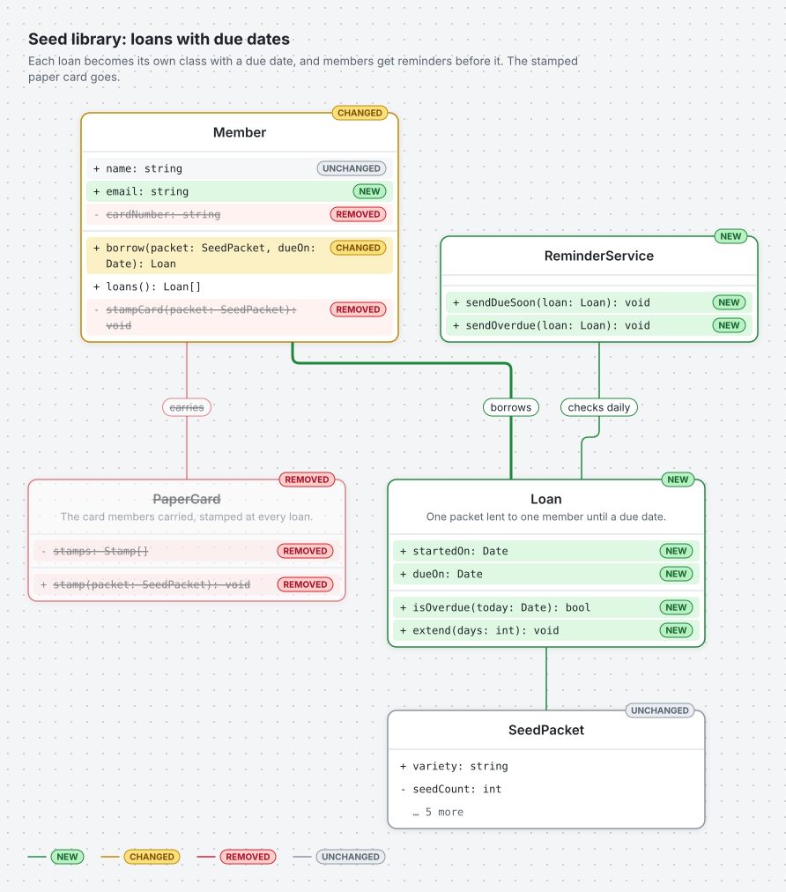
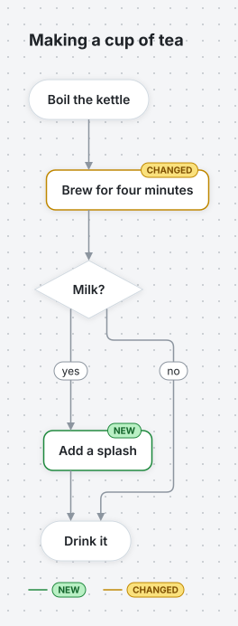
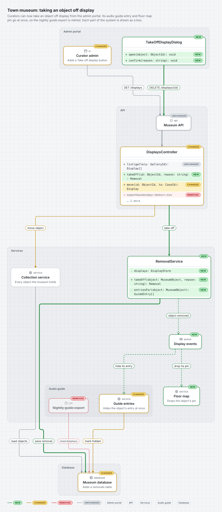
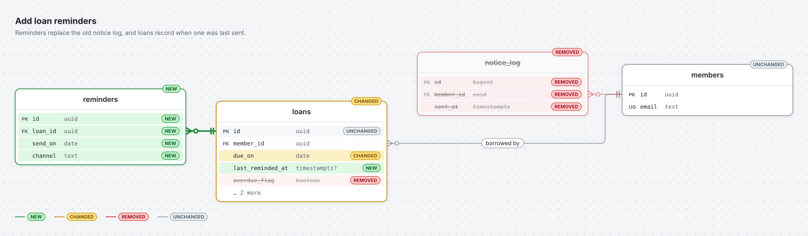
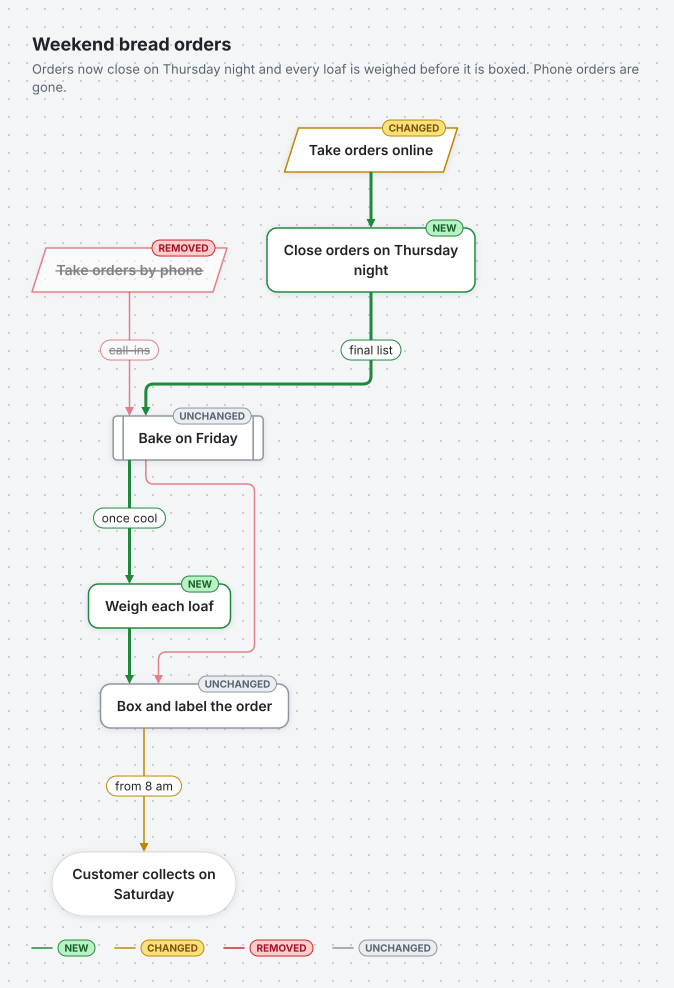
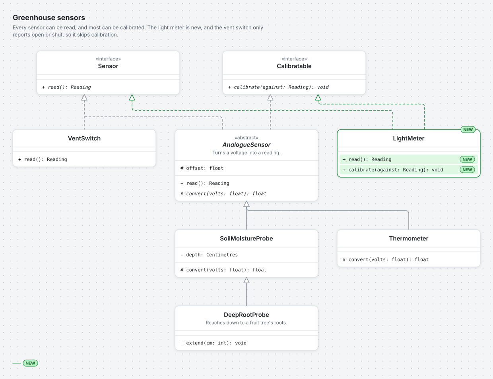

# Structa

**Structa turns a JSON description of a diagram into a clean SVG or PNG.** You say what's in the diagram and how it connects. Structa works out where everything goes, draws it, and colour-codes what is new, changed or removed.

It is built for AI agents. The whole tool is one JavaScript file that runs on plain Node. Drop it into a skills folder and an agent can draw class, ER, flowchart and architecture diagrams with a single command, with nothing to install.

<p align="center">
  <picture>
    <source media="(prefers-color-scheme: dark)" srcset="docs/images/class-status-dark.svg">
    
  </picture>
</p>

## What it does

- **Four diagram types:** class diagrams, ER (database) diagrams, flowcharts and architecture diagrams.
- **Automatic layout:** cards are placed and lines are routed for you, using the [Eclipse Layout Kernel](https://github.com/kieler/elkjs). You never give coordinates.
- **Change at a glance:** every card, row and line can be marked `new`, `changed`, `removed` or `unchanged`. Each gets its own colour and a badge, and removed parts stay in the picture, faded and struck through.
- **Areas:** group cards into areas such as "Admin portal", "API" and "Database". They show as a tag on each card, or as nested boxes.
- **Light and dark themes**, with the fonts embedded, so diagrams look the same everywhere.
- **SVG or PNG:** PNG export is built in, with no browser or native libraries needed.
- **Strict, helpful errors:** a mistake in the JSON is reported with its exact location and a hint, all problems at once.
- **The same output every time:** with the same version of Structa, the same JSON always gives byte-for-byte the same image, so diagrams diff cleanly.

## A first diagram

Write the diagram as JSON:

```json
{
  "type": "flow",
  "title": "Making a cup of tea",
  "nodes": [
    { "id": "boil", "label": "Boil the kettle", "shape": "start" },
    { "id": "brew", "label": "Brew for four minutes", "shape": "step", "status": "changed" },
    { "id": "milk", "label": "Milk?", "shape": "decision" },
    { "id": "splash", "label": "Add a splash", "shape": "step", "status": "new" },
    { "id": "drink", "label": "Drink it", "shape": "end" }
  ],
  "edges": [
    { "from": "boil", "to": "brew" },
    { "from": "brew", "to": "milk" },
    { "from": "milk", "to": "splash", "label": "yes" },
    { "from": "milk", "to": "drink", "label": "no" },
    { "from": "splash", "to": "drink" }
  ]
}
```

Then draw it:

```sh
node structa.mjs tea.json -o tea.png
```

<p align="center">
  <picture>
    <source media="(prefers-color-scheme: dark)" srcset="docs/images/quick-start-dark.svg">
    
  </picture>
</p>

## Examples

Every example below is drawn from a file in [`examples/`](examples). The images switch with your GitHub theme.

### Architecture: a change across a whole system

An admin portal, an API, services and a database, each drawn as an area box. Class cards show exactly which methods change; component cards stand for the UI, API, services, queue and database. From [`examples/architecture-change-map.json`](examples/architecture-change-map.json).

<p align="center">
  <picture>
    <source media="(prefers-color-scheme: dark)" srcset="docs/images/architecture-change-map-dark.svg">
    
  </picture>
</p>

### ER: a schema change

Tables with their columns, keys and types. Relationship lines land on the exact columns they join, with crow's-foot ends. From [`examples/er-status.json`](examples/er-status.json).

<p align="center">
  <picture>
    <source media="(prefers-color-scheme: dark)" srcset="docs/images/er-status-dark.svg">
    
  </picture>
</p>

### Flowchart: a process that changes

Start and end pills, steps, decisions, input/output and subprocess shapes, with labelled and looping lines. From [`examples/flow-status.json`](examples/flow-status.json).

<p align="center">
  <picture>
    <source media="(prefers-color-scheme: dark)" srcset="docs/images/flow-status-dark.svg">
    
  </picture>
</p>

### Class: a UML hierarchy

Interfaces, abstract classes in italics, visibility symbols, and the standard UML lines for inheriting, implementing, owning and using. Parents always sit above their children. From [`examples/class-hierarchy.json`](examples/class-hierarchy.json).

<p align="center">
  <picture>
    <source media="(prefers-color-scheme: dark)" srcset="docs/images/class-hierarchy-dark.svg">
    
  </picture>
</p>

You can see every example in both themes on one page by running `bun run gallery` (see [Developing Structa](#developing-structa)).

## Getting Structa

Structa ships as a ready-made **skill folder**:

| File | What it is |
|---|---|
| `structa.mjs` | the tool: the command line and the library |
| `elk.bundled.js` | the layout engine, elkjs, unchanged |
| `package.json` | one line that lets elkjs load anywhere |
| `structa.schema.json` | the JSON Schema for diagram files |
| `examples/` | a working example of every diagram type |
| `SKILL.md` | instructions that teach an agent to use Structa |
| `licenses/` | licences for Structa and everything it ships |

Each [GitHub Release](https://github.com/Jamie-Fairweather/Structa/releases) attaches this folder as `structa.zip`. Unzip it into your agent's skills directory and it's ready to use. You can also build it yourself; see [Developing Structa](#developing-structa).

All you need is **Node 20 or newer**. There is nothing to install, and nothing is fetched from the internet.

## Using it

### From the command line

```sh
node structa.mjs diagram.json -o diagram.png                   # draw a PNG
node structa.mjs diagram.json -o diagram.svg -o diagram.png    # both, from one layout
node structa.mjs diagram.json --theme dark -o diagram.png      # dark theme
node structa.mjs diagram.json --scale 4 -o diagram.png         # a larger PNG (default 2)
node structa.mjs diagram.json --no-embed-fonts -o diagram.svg  # a smaller SVG
node structa.mjs diagram.json > diagram.svg                    # no -o: SVG to stdout
node structa.mjs example architecture                          # print a working example
node structa.mjs schema                                        # print the JSON Schema
```

Exit codes: `0` success, `1` bad input or a failed render (each problem on its own line on stderr), `2` bad usage. Run `node structa.mjs --help` for the full list.

### From JavaScript

```js
import { readFile } from "node:fs/promises";
import { render, StructaError } from "./structa.mjs";

try {
  const json = await readFile("diagram.json", "utf8");
  const { svg, png } = await render(json, { formats: ["svg", "png"], theme: "dark", scale: 2 });
} catch (error) {
  if (error instanceof StructaError) console.error(error.code, error.problems);
}
```

`render()` takes a JSON string or an object. Its options are:

- `formats`: `["svg"]` (default) and/or `"png"`;
- `theme`: `light` (default) or `dark`;
- `scale`: a PNG scale from 1 to 4 (default 2);
- `embedFonts`: `true` (default) or `false`.

It returns only the outputs you asked for: `svg` as a string and `png` as a `Uint8Array`. On failure it throws a `StructaError`, whose `code` is `INVALID_INPUT`, `INVALID_OPTIONS`, `TOO_LARGE` or `LAYOUT_FAILED` and whose `problems` list says what went wrong and where.

### From an agent

Put the skill folder in your agent's skills directory. `SKILL.md` teaches the agent:

- when each diagram type helps;
- how to write the JSON;
- how to mark changes honestly;
- when to group cards into areas;
- what to do when a diagram is too big.

## Writing diagrams

Every diagram is one JSON file with a `type` (`class`, `er`, `flow` or `architecture`), a list of `nodes`, and a list of `edges` between them. Every type shares the same building blocks:

- **`id` and `label`** on every node. Edges refer to nodes by id.
- **`status`**, optional, on cards, rows and lines: `new`, `changed`, `removed` or `unchanged`. A diagram with no statuses is drawn in plain neutral colours.
- **`areas`**, declared once, with `"area": "<id>"` on each card. Areas can nest by naming a `parent`. Set `"groupAreas": true` to draw them as boxes.
- **`title` and `description`**, drawn at the top-left.
- **`direction`**, `down` or `right`. This is the only layout setting; the order you list nodes in gently guides the rest.

The best way to learn the rest is to start from `node structa.mjs example <type>` and check your file against the schema from `node structa.mjs schema`. A diagram can have up to 500 cards, 1,000 lines and 100 rows per card. Text is plain, in Latin-script letters and common symbols.

## Developing Structa

Structa is written in TypeScript and uses [Bun](https://bun.sh) for its dev tools. Tests run under Node, as agents run it.

```sh
bun install              # install dev tools and the commit-message hook
bun run test             # the full test suite (add a file path to run one file)
bun run typecheck        # type-check everything
bun run build            # build the skill folder into dist/structa/
bun run gallery          # draw every example, light and dark, into dist/gallery/index.html
bun run readme-images    # redraw this README's pictures into docs/images/
bun run release          # build dist/structa.zip, as the release workflow does
```

Commits and PR titles follow [Conventional Commits](https://www.conventionalcommits.org). Pushing a version tag such as `v1.0.0` publishes a GitHub Release with the skill folder attached. [`AGENTS.md`](AGENTS.md) has the conventions for working on the code.

## Licence

Structa is [MIT licensed](LICENSE). The skill folder also ships:

- elkjs, the layout engine (EPL-2.0), kept as its own unmodified file;
- resvg-wasm, for drawing PNGs (MPL-2.0);
- the Inter and JetBrains Mono fonts (SIL Open Font Licence).

Their licences and source links are in the `licenses/` folder of every build.
